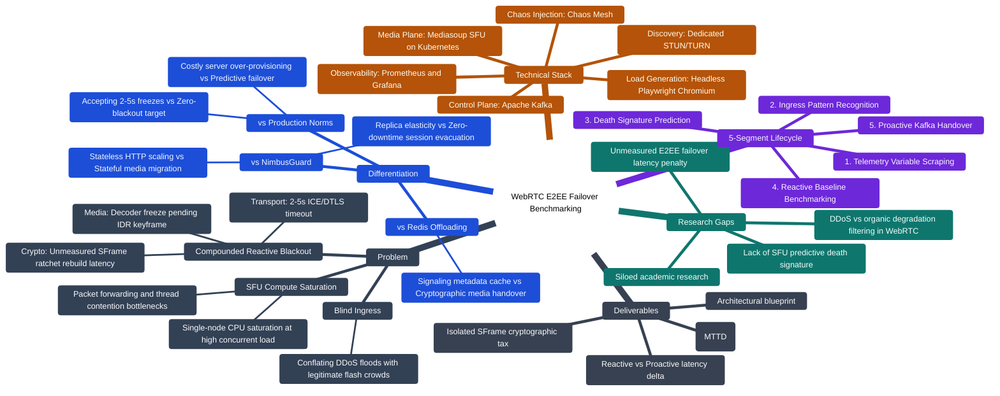

### 1. The Three Tiers of "State" in WebRTC

When an HTTP pod scales, a load balancer simply hands the next independent request to the new pod. A WebRTC video call, however, maintains three tightly coupled layers of state that cannot be duplicated with a simple load-balancing rule:

- **Transport State (OS & Network Layer):** Active peers maintain persistent, negotiated UDP sockets, NAT hole-punch bindings, and dynamic ICE candidate pairings. You cannot transparently route an in-flight UDP media stream from one IP to another without breaking the socket.
    
- **Media Pipeline State (Application Layer):** Video codecs (VP8, VP9, H.264, AV1) rely on temporal compression. Video frames depend on previous frames (P-frames/B-frames). If a client switches to a new server without that exact codec state, decoding breaks until an Intra-coded (IDR) keyframe is requested (via RTCP PLI/FIR), introducing video freezes.
    
- **Cryptographic Ratchet State (Security Layer):** Under application-layer E2EE (SFrame / Insertable Streams), each client maintains an evolving cryptographic ratchet. An SFU cannot forward or inspect this state because it operates under zero-trust. If a client reconnects to a new SFU, the cryptographic session context must be resynchronized, creating an unmeasured blackout window.
    

### 2. How the Industry "Solves" This Today (The Workarounds)

Because seamless, proactive stateful failover is so hard, production platforms (like Zoom, Google Meet, and LiveKit) do not actually have an automated zero-downtime failover engine. Instead, they rely on three compromises:

1. **Massive Over-Provisioning:** Platforms typically run SFU servers at 30% to 50% CPU capacity so they rarely approach the crash threshold (Michel et al., 2025). This avoids the failover problem entirely, but at massive cloud infrastructure costs.
    
2. **Brute-Force Reactive Reconnection:** If an SFU crashes, platforms let the call drop. The client waits for a heartbeat timeout (typically 2 to 5 seconds), realizes the media server is dead, queries the signaling server for a new node, renegotiates ICE, and re-establishes the video feed. For the user, this means several seconds of frozen video or black screens.
    
3. **Stateless Control Planes with Stateful Media Nodes:** Modern systems externalize signaling state (room metadata, participant lists) to Redis clusters (Nagy et al., 2026). While this enables quick signaling recovery, it completely ignores the media transport and SFrame cryptographic resynchronization.
    

### 3. Why This Is Not Solved in the Literature

If a unified, proactive E2EE failover solution already existed, recent literature would not be actively grappling with isolated pieces of the problem:

- **Michel et al. (SIGCOMM 2025)** had to redesign SFU hardware forwarding because software media servers still saturate and fail under concurrent packet loads.
    
- **Chicano-Capelo et al. (IEEE Access 2025)** proved that even top-tier SFUs like Mediasoup and Pion suffer severe QoE collapses when hitting CPU saturation, with no automated mechanism to evacuate calls gracefully before a crash.
    
- **Nagy et al. (IEEE TNSM 2026)** managed to reduce session state failover to 60–120 ms using externalized state, but explicitly tested plain media and acknowledged that cryptographic resynchronization remains unmeasured.
    
- **SFrame and Insertable Streams (2023–2025)** are relatively recent W3C/IETF specifications. Research into their performance overhead during distributed server migrations is brand new.

